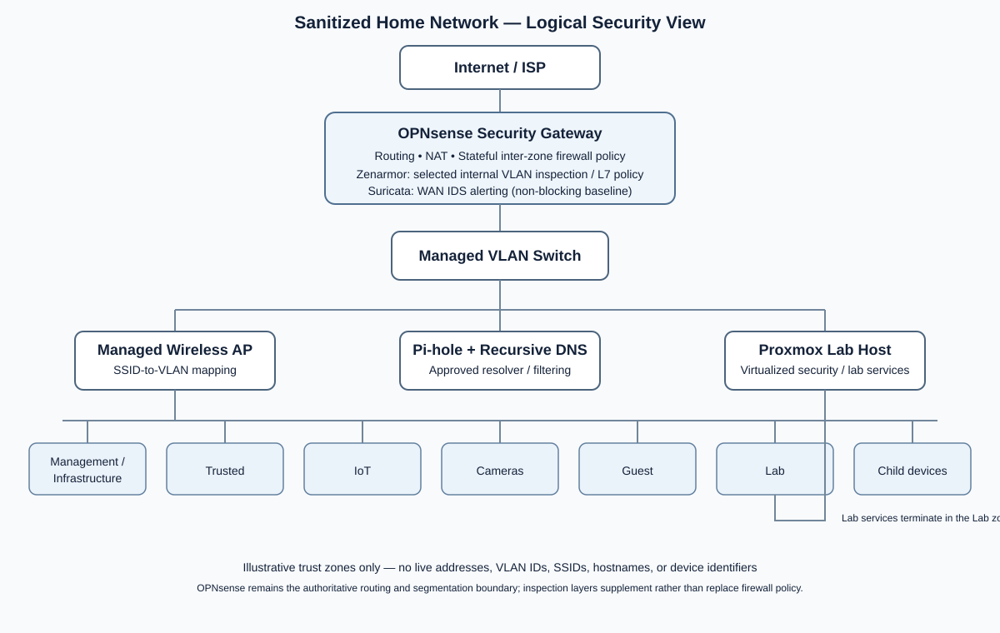

# Home Lab Security Architecture

A public, sanitized security-engineering case study of a segmented home network. This repository documents **currently deployed controls**, the owner's reported verification results, limits of those results, and a separate backlog for improvements still being tuned or validated.

> **Deployment snapshot: November 16, 2026.** Deployed/configured descriptions are based on owner reports and existing documentation, **not an independent audit**. Baseline segmentation checks have been reported passing, but dated sanitized test transcripts are still incomplete. Features described as observation-only or pending validation are not presented as production-grade prevention.

## Current network architecture

The reported deployment uses a dedicated **OPNsense firewall** for routing and inter-VLAN policy enforcement; a managed **TP-Link Omada SG2008P** switch; managed Wi-Fi; a Raspberry Pi running **Pi-hole with local recursive DNS**; and a **Proxmox** virtualization host. A separate **GL.iNet Beryl AX** travel router provides an owner-tested WireGuard IPv4 tunnel back to home OPNsense.

Logical zones separate management/infrastructure, trusted endpoints, IoT, cameras, guests, lab systems, and child devices. Application-aware inspection is provided by **Zenarmor** on selected internal VLANs. **Suricata is enabled on WAN in IDS-only PCAP mode** with a curated Emerging Threats Open ruleset; it is currently used for alerting and baseline tuning, not inline blocking.

## Deployment and verification status

| Capability | Current status | Evidence / limitations |
| --- | --- | --- |
| OPNsense gateway and zone-based inter-VLAN routing | **Deployed** | Exact configurations excluded from public repository |
| Omada managed switch and Wi-Fi VLAN mapping | **Deployed** | Private addresses/SSIDs/device identifiers omitted |
| Management/trusted/IoT/camera/guest/lab/child zones | **Deployed/configured** | Segmentation checks owner-reported; regression evidence remains to be published |
| IoT/camera → trusted/management isolation | **Configured** | Explicit inter-zone deny policy with scoped exceptions |
| Guest internet-only policy and captive portal | **Configured** | Portal is an access layer; firewall isolation remains authoritative |
| Pi-hole + local recursive DNS | **Deployed** | Approved resolver; DNS availability is operationally significant |
| Traditional DNS / DoT bypass controls | **Configured on restricted zones** | External port 53 and TCP/853 controls do not alone prove all encrypted-DNS bypass is impossible |
| Zenarmor application-aware filtering | **Deployed on selected internal VLANs** | Subnet-scoped policies are used for IoT, cameras, guest and child zones; trusted traffic receives a baseline fallback policy |
| IoT / smart-TV telemetry controls | **Partially deployed and under observation** | Pi-hole category/domain controls, firewall egress policy and Zenarmor reduce exposure; no claim of complete ACR/telemetry elimination |
| Suricata WAN IDS | **Running in alert-only mode** | PCAP live mode, Hyperscan matcher, syslog/EVE logging, curated ET Open rules; IPS/drop actions not yet enabled |
| Travel-router WireGuard VPN to home OPNsense | **Deployed; selected tunnel-up tests owner-validated** | Full fail-closed/DNS/IPv6/captive-portal field matrix still pending |
| Complete child-device destination allowlist | **In progress** | Layer-7 restrictions are deployed, but a comprehensive destination allowlist is not yet claimed |
| Centralized SIEM / long-term log collector | **Planned** | No claim of production SIEM coverage |

### Current layered control model

- **OPNsense:** routing, stateful firewalling, inter-zone segmentation and explicit service exceptions.
- **Pi-hole / recursive DNS:** DNS filtering and resolver control.
- **Zenarmor:** application/category visibility and policy enforcement on selected internal zones.
- **Suricata:** WAN-side signature IDS and alert generation, currently non-blocking.
- **WireGuard:** authenticated remote/travel access with separately scoped firewall policy.

### What the existing controls cannot prove

- DNS filtering and DoH/DoT application controls do **not** prove that all telemetry or covert channels are eliminated.
- Application classification is not equivalent to decrypting TLS payload contents; TLS interception is not part of the current deployment.
- WAN IDS visibility is limited by NAT, encryption, rule coverage and the traffic that actually traverses the selected interface.
- VLAN separation depends on correctly scoped gateway policy, management restrictions and repeatable positive/negative tests.
- A running IDS does not equal tuned IPS prevention; Suricata remains alert-only until the rulebase is baselined and selectively promoted.

See [current deployment and trust-boundary limitations](docs/deployment-and-threat-boundaries.md) for the narrower security claims.

## Repository guide

| Document | Purpose |
| --- | --- |
| [Architecture](docs/architecture.md) | Components, packet paths and trust boundaries |
| [Threat model](docs/threat-model.md) | Assets, assumptions, threats and residual exposure |
| [Segmentation](docs/network-segmentation.md) | Security zones and intended access |
| [Firewall policy](docs/firewall-policy.md) | **Conceptual** policy matrix, not the live OPNsense export |
| [Validation](docs/validation-tests.md) | Baseline **owner-reported** passing tests |
| [Design decisions](docs/design-decisions.md) | Architectural decisions and trade-offs |
| [Current deployment & limits](docs/deployment-and-threat-boundaries.md) | Present controls versus remaining exposure |
| [Hardening roadmap](docs/hardening-roadmap.md) | Current tuning and validation backlog |
| [Hardened travel router](docs/secure-travel-router.md) | Deployed WireGuard home tunnel and unresolved field checks |
| [Validation evidence template](docs/validation-evidence-template.md) | Procedure for dated, scoped, sanitized testing |
| [Example policies](examples/policy-pseudocode.md) | Illustrative pseudocode, not production config |

## Engineering priorities

1. Complete regression testing after enabling Zenarmor on the intended internal interfaces and confirm each restricted subnet maps to its intended policy.
2. Baseline Suricata WAN IDS alerts, document false positives and only then evaluate selective IPS/drop actions for high-confidence signatures.
3. Publish dated, sanitized allow/deny evidence for segmentation, DNS enforcement, guest isolation and key application flows.
4. Continue smart-TV/IoT egress observation and narrow unnecessary telemetry without breaking required streaming, update or account services.
5. Re-test the travel-router tunnel for fail-closed behavior and DNS/IPv6 leakage on external networks.
6. Add protected centralized logging only after retention, storage and access-control requirements are defined.

Detailed sequencing is in the [hardening roadmap](docs/hardening-roadmap.md).

## Public disclosure policy

This repository intentionally excludes internal addressing, WAN IPs, SSIDs, MAC addresses, device identifiers, serial numbers, hostnames, actual firewall/Zenarmor policy exports, live packet captures, credentials, VPN keys, and production backup files. Published examples must be synthetic or reviewed and sanitized. Results here are not a third-party security certification.

## License

Documentation is made available under [CC BY 4.0](LICENSE). Example policies are educational and should be reviewed before applying elsewhere.
