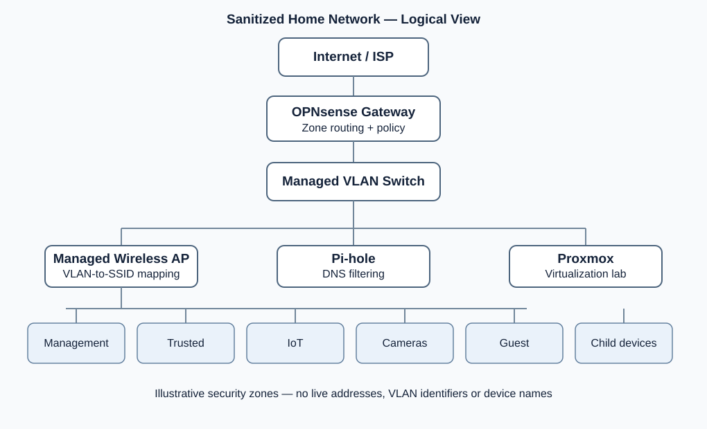

# Home Lab Security Architecture

A public, sanitized security-engineering case study of a segmented home network. This repository documents **currently deployed controls**, the owner's reported verification results, limits of those results, and a separate backlog for proposed improvements.

> **Deployment snapshot: October 24, 2026.** Deployed/configured descriptions are based on owner reports and existing documentation, **not an independent audit**. Eleven baseline checks have been reported passing, but dated sanitized test transcripts have not yet been published. **Planned features are not claimed to be operating today.**

## Current network architecture

The reported deployment uses a dedicated **OPNsense firewall** for routing and inter-VLAN policy enforcement; a managed **TP-Link Omada SG2008P** switch; managed Wi-Fi; a Raspberry Pi running **Pi-hole**; and a **Proxmox** virtualization host. A separate **GL.iNet Beryl AX** travel router provides an owner-tested WireGuard IPv4 tunnel back to home OPNsense. Logical zones separate management, trusted endpoints, IoT, cameras, guests and child devices. Proxmox is part of the described lab architecture, but **no planned IDS/SIEM workloads are claimed to be active**.

## Deployment and verification status

| Capability | Current status | Evidence / limitations |
| --- | --- | --- |
| OPNsense gateway and zone-based inter-VLAN routing | **Deployed** | Exact configurations excluded from public repository |
| Omada managed switch and Wi-Fi VLAN mapping | **Deployed** | Private addresses/SSIDs/device identifiers omitted |
| Management/trusted/IoT/camera/guest/child zones | **Deployed/configured** | Segmentation checks owner-reported, not independently replayed |
| IoT/camera → trusted/management isolation | **Configured** | Relevant baseline tests owner-reported passing |
| Guest internet-only policy and captive portal | **Configured** | Guest isolation/access tests owner-reported passing |
| Pi-hole filtering | **Configured** | Approved resolver for policy-controlled DNS |
| IoT DNS port 53 / external DNS-over-TLS port 853 controls | **Reported configured** | Restricts specified ports; **not a universal DoH or telemetry block** |
| General IoT outbound internet egress | **Present — known limitation** | Encrypted vendor traffic, telemetry and DoH may remain possible |
| Eleven baseline validation checks | **Owner-reported passing** | Dated sanitized evidence/revisions still to be published |
| Complete child-device destination allowlist | **In progress** | Individual blocked-site tests do not establish comprehensive allowlisting |
| Unbound/Pi-hole integration | **To verify** | Not claimed deployed or correctly integrated |
| Travel-router WireGuard VPN to home OPNsense | **Deployed; selected tunnel-up tests owner-validated** | Full-tunnel IPv4 and Pi-hole path tested; external-network fail-closed, DNS/IPv6 leak and captive-portal cases still pending |
| LG TV strict outbound allowlisting / ACR controls | **Planned, not verified** | No claim all smart-TV telemetry is eliminated |
| Zenarmor / application-aware IoT restrictions | **Planned, not deployed** | Evaluate only with compatibility, performance and rollback tests |
| Dedicated SPAN/mirror-port sensor, Suricata/Zeek | **Planned, not deployed** | OPNsense will remain the firewall |
| Centralized logging / Wazuh / SIEM | **Planned, not deployed** | No claim of ongoing centralized detection |

### What the existing controls cannot prove

- Restricting external TCP/UDP 53 and TCP 853 does **not** establish that clients cannot resolve names over HTTPS/443 (DoH).
- Pi-hole blocklists cannot guarantee suppression of all vendor telemetry, LG TV automatic-content-recognition traffic, or connections to embedded IP addresses.
- VLAN separation must be backed by correctly scoped gateway policy, management access restrictions, and repeatable tests.
- Unencrypted metadata visibility is not the same as reading TLS-encrypted application payloads.
- A switch mirror of the firewall uplink will not necessarily see intra-VLAN or all wireless-client traffic.

See [current deployment and trust-boundary limitations](docs/deployment-and-threat-boundaries.md) for the narrower security claims.

## Repository guide

| Document | Purpose |
| --- | --- |
| [Architecture](docs/architecture.md) | Components, packet paths and trust boundaries |
| [Threat model](docs/threat-model.md) | Assets, assumptions, threats and residual exposure |
| [Segmentation](docs/network-segmentation.md) | Security zones and intended access |
| [Firewall policy](docs/firewall-policy.md) | **Conceptual** policy matrix, not the live OPNsense export |
| [Validation](docs/validation-tests.md) | Eleven baseline **owner-reported** passing tests |
| [Design decisions](docs/design-decisions.md) | Architectural decisions and trade-offs |
| [Current deployment & limits](docs/deployment-and-threat-boundaries.md) | Present DNS/IoT controls versus remaining exposure |
| [Hardening roadmap](docs/hardening-roadmap.md) | **Future work only**; unchecked means not established |
| [Hardened travel router](docs/secure-travel-router.md) | Deployed WireGuard home tunnel, tested controls, unresolved field checks |
| [Validation evidence template](docs/validation-evidence-template.md) | Procedure for dated, scoped, sanitized testing |
| [Example policies](examples/policy-pseudocode.md) | Illustrative pseudocode, not production config |

## Engineering priorities

1. Reconfirm the present firewall policy and safely back up the configuration **outside GitHub**.
2. Re-run zone isolation and DNS tests with dated, sanitized evidence.
3. Observe LG TV dependencies before narrowing outbound traffic; test DoH/QUIC hypotheses rather than assuming DNS blocking is complete.
4. Evaluate a separate, passive IDS sensor on a supported switch mirror port. Do **not** replace the existing firewall.
5. Re-test the travel-router tunnel for fail-closed behavior and DNS/IPv6 leaks on external networks.
6. Document new findings, service regressions, rollbacks and subsequent configuration changes.

Detailed acceptance criteria and sequencing are in the [hardening roadmap](docs/hardening-roadmap.md). **These are not current deployment claims.**

## Public disclosure policy

This repository intentionally excludes internal addressing, WAN IPs, SSIDs, MAC addresses, device identifiers, serial numbers, hostnames, actual firewall rule exports, live packet captures, credentials, VPN keys, and production backup files. Published examples must be synthetic or reviewed and sanitized. Results here are not a third-party security certification.

## License

Documentation is made available under [CC BY 4.0](LICENSE). Example policies are educational and should be reviewed before applying elsewhere.
